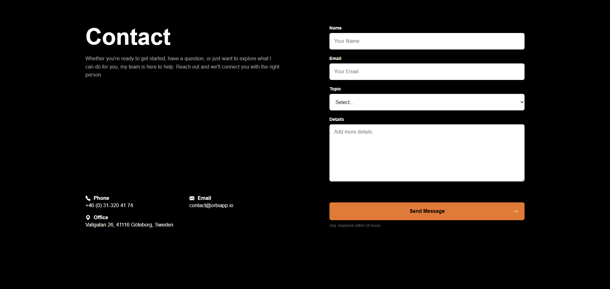

# Responsive Contact Page

🔗 **[View the Live Demo Here](https://tahasoumbate.github.io/Responsive-Contact-Page/)**

A modern, fully responsive contact page built from scratch using HTML5 and CSS3. This project focuses on clean UI design, semantic HTML, and advanced CSS layout techniques (Flexbox and Grid).

## 📸 Preview

## 🚀 Features

- **Modern Dark Theme:** A sleek, high-contrast UI that matches the provided design.
- **Fully Responsive:** Uses CSS Media Queries to stack the layout gracefully on mobile devices.
- **Semantic HTML:** Utilizes `<address>`, `<form>`, `<label>`, and `<input>` tags for better SEO and accessibility.
- **Accessible Forms:** Includes custom focus states (`:focus`) for keyboard navigation and accessible labels for screen readers.
- **Perfect Alignment:** Uses CSS Flexbox `margin-top: auto` to ensure the submit button perfectly aligns with the bottom of the contact information block.
- **CSS Grid:** Uses Grid to create a neat two-column layout for the contact details (Phone, Email, Office).

## 🛠️ Built With

- **HTML5** - Semantic structure.
- **CSS3** - Styling, Flexbox, CSS Grid, Media Queries.
- **Inline SVG** - For crisp, scalable icons.

